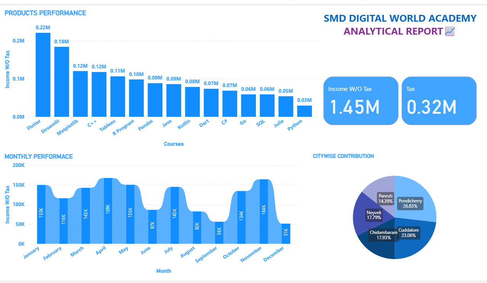
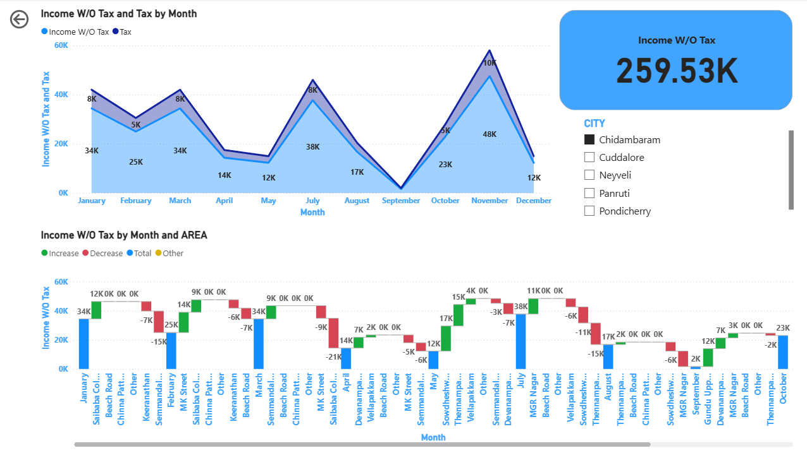
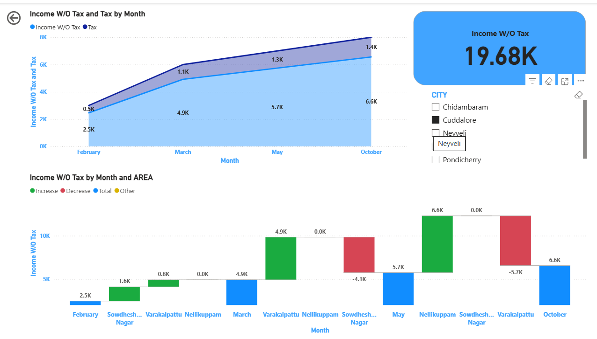
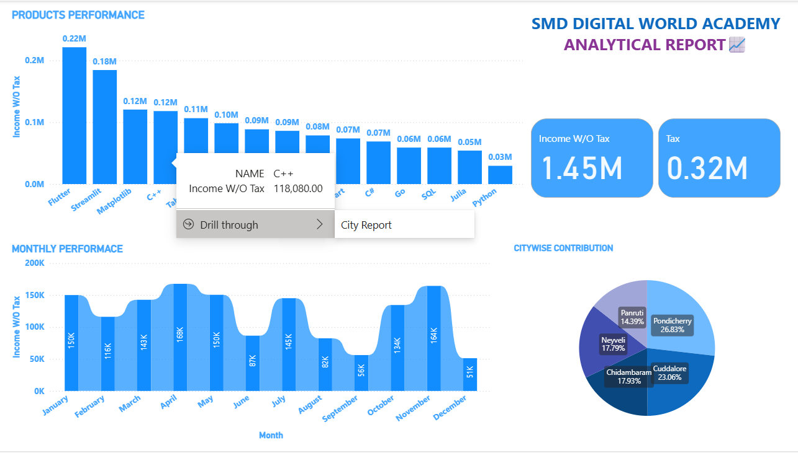
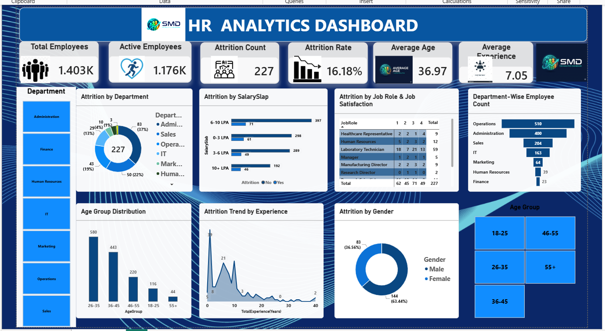

# 📊 SMD Digital World Academy & HR Analytics - Power BI Portfolio

Welcome to my central Power BI Portfolio repository! This repository showcases interactive, end-to-end Business Intelligence dashboards covering financial course performance, student enrollment, regional sales, and workforce HR statistics.

> 🔒 **Security Notice:** The underlying Power BI Desktop source files (`.pbix`) are retained privately to protect custom DAX metrics, data model structures, and proprietary dashboard layouts. High-resolution previews and live interactive reports are provided below for evaluation.
---

## 1. 🎓 SMD Digital World Academy - Power BI Analytical Report

### 📌 Project Overview
An end-to-end financial analysis report built in Microsoft Power BI for SMD Digital World Academy. This report presents an in-depth financial analysis covering course performance, monthly revenue trends, tax distributions, and regional city-wise contributions.

### 🔗 Live Interactive Dashboard
- 🌐 [Click Here to Access Live Interactive Dashboard](https://app.powerbi.com/reportEmbed?reportId=5e95cbd6-a0d6-42e8-b41e-09d100de2ac8&autoAuth=true&ctid=942c63cd-bc72-4c8b-8d54-23053db261b8)

### 🖼️ Dashboard Previews & Visualizations

### 💡 Key Business Insights
- **Total Revenue (W/O Tax):** $1.45M generated across overall product sales.
- **Total Tax Collected:** $0.32M accounted in the performance period.
- **Top Revenue Drivers:** Flutter ($0.22M) and Streamlit ($0.18M) registered the highest enrollment demand.
- **Regional Performance:** Pondicherry leads regional sales with 26.83% contribution, followed by Cuddalore at 23.00%.

### 🛠️ Tools & Technologies Used
- **Business Intelligence Platform:** Microsoft Power BI Desktop & Power BI Service
- **Data Transformation & DAX:** Power Query, Custom DAX Calculated Measures & Columns
- **Visualizations:** Area Charts, Horizontal Bar Charts, Donut Charts, Waterfall Charts, and Interactive Slicers

---

## 2. 👥 HR Analytics & Workforce Attrition Dashboard

### 📌 Project Overview
An interactive HR Analytics dashboard designed to track employee demographics, attrition factors, income distributions, and department-wise turnover to improve workforce retention strategies.

### 🔗 Live Interactive Dashboard
- 🌐 [Click Here to Access Live Interactive Dashboard](https://app.powerbi.com/reportEmbed?reportId=711ab1e1-306d-43a3-b622-53cf1ff361f1&autoAuth=true&ctid=942c63cd-bc72-4c8b-8d54-23053db261b8)

### 🖼️ Dashboard Preview & Visualization

### 💡 Key Business Insights
- **Workforce Attrition Drivers:** Visualized attrition rates across employee age groups, roles, education backgrounds, and department tenure.
- **Compensation & Satisfaction Analysis:** Modeled monthly salary scales against job satisfaction and work-life balance scores.
- **Employee Metrics Tracking:** Dynamic KPI cards for Active Employees, Attrition Count, and Attrition Rate percentage.

### 🛠️ Tools & Technologies Used
- **Business Intelligence Platform:** Microsoft Power BI Desktop & Power BI Service
- **Data Transformation & Modeling:** Power Query Editor, Custom DAX Measures
- **Visualizations:** KPI Cards, Donut Charts, Matrix Tables, Horizontal Bar Charts, Dynamic Slicers

---

## 👤 Author & Contact
- **Developer:** Mohamed Moufaq S
- **Domain:** Data Analytics & Power BI
- **GitHub:** [github.com/Mohamedmoufaq](https://github.com/Mohamedmoufaq)
